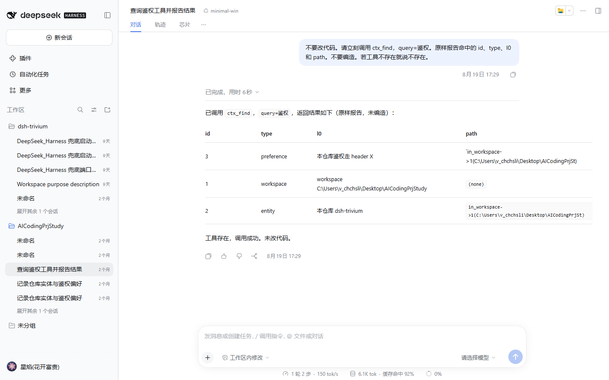
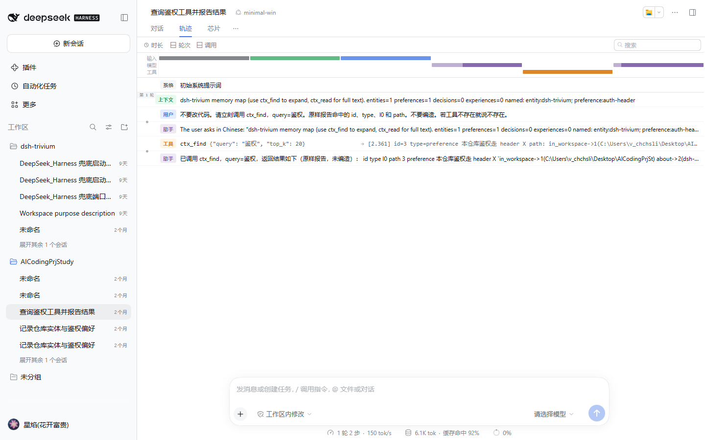
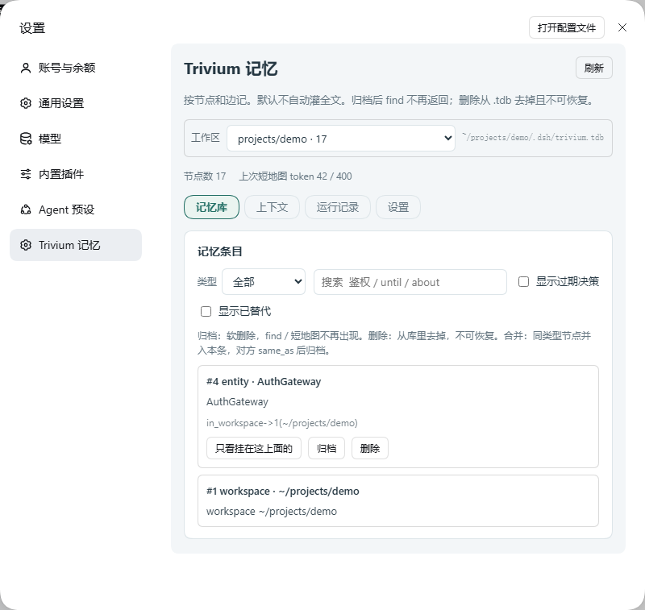
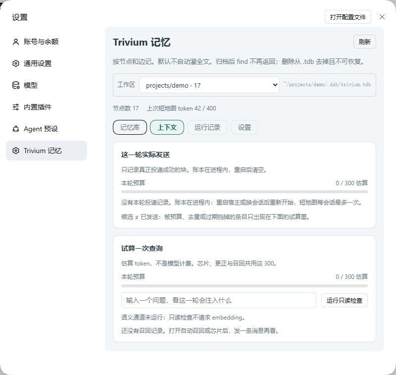
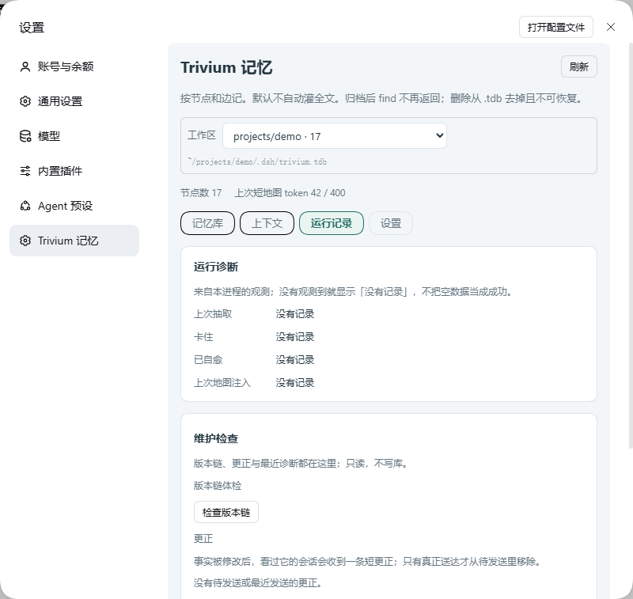
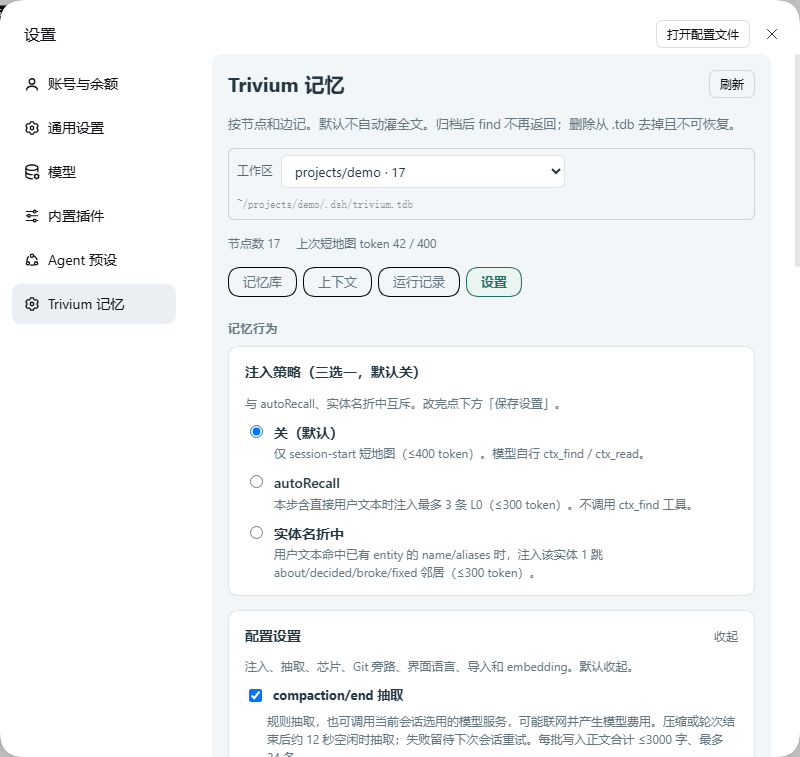
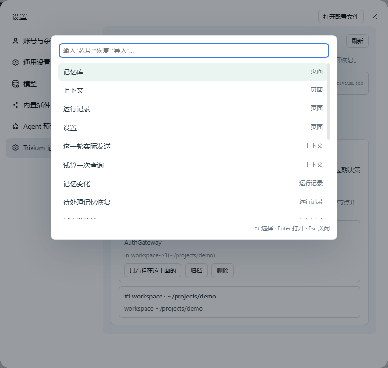
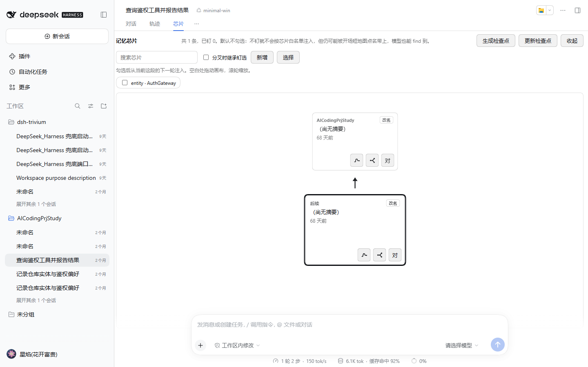

# dsh-trivium — In-process graph memory for DeepSeek Harness

<p align="center">
  
</p>

In-process graph memory for DeepSeek Harness. One `.tdb` per workspace. No extra server.

The kernel stays close to DSH: no extra process, no extra nav by default. Pin memory fragments with optional chip inject; the plot canvas is an optional extra, loaded from Settings.

> **Quick install**: `dsh plugin --profile web add dsh-trivium` → restart **dsh web** → open a workspace (Settings shows **Trivium memory**; the **Chips** tab stays off until you turn it on). Details in [Installation](#installation).

[**English**](README.md) | [中文版](README.zh-CN.md)

The published npm package is **0.8.9**. Workspace switches discard stale memory actions, proposal tokens use canonical paths, and chip writes share the workspace lock. Read-only live TQL and independently captured snapshots let you inspect memory while DSH owns the writer. [English release notes](docs/release-0.8.9.en.md)

> **Back up the whole `.dsh` directory (with the plugin closed) before upgrading from 0.8.4 or earlier** (0.8.5 through 0.8.9 already ship `0.9.0`, so there is nothing to convert if you are on any of them).
> 0.9.0 raises the library format to **v10** and the previous kernel cannot read it
> (`TDB_UNSUPPORTED_DATABASE_VERSION`), so **downgrading the plugin is not a rollback** — restoring a backup is,
> and a restore returns the library to the moment of the backup, losing everything written after it.
> Copy the **whole file group** (`trivium.tdb` plus `.gidx` `.pidx` `.pld.*` `.text` `.text.meta` `.vec` `.wal`
> `.lock` `.flush_ok`); copying only `.tdb` yields `TDB_CORRUPTED_FILE`.

---

## Installation

> Prerequisite: install [DeepSeek Harness](https://github.com/deepseek-ai/deepseek-harness) and start `dsh web` at least once. Current Web verification uses `0.2.2-rc.1` (2026-11-10, real host launch); see the [baseline and evidence index](docs/README.md) for desktop `0.2.1-rc.3` coverage and limitations. Node must satisfy `^22.19.0 || >=24`; `triviumdb` is pinned to `0.9.0`.

```sh
dsh plugin --profile web add dsh-trivium
```

Restart **dsh web**. Memory lives in the current workspace:

```
<workspace>/.dsh/trivium.tdb      # local index (binary; gitignore this)
<workspace>/.dsh/trivium.jsonl    # optional Git exchange snapshot (business facts)
```

Commit `trivium.jsonl`. Ignore the binary store:

```gitignore
.dsh/trivium.tdb
.dsh/trivium.tdb*
.dsh/trivium-pending.json
.dsh/consumer-preferences/
.dsh/trivium-changes.jsonl*
```

Clone / `git pull` re-imports when the jsonl changed. Settings → **Git sidecar** is **off** by default (same as chips). Turn it on under **Settings** (the fold below Check for updates). The switch only starts or stops auto-write. **Generate** (while on) overwrites `.dsh/trivium.jsonl` from the current `.tdb` at the same path. **Delete jsonl** (while off) removes known workspace jsonl files (`.tdb` stays). Episodes, embeddings, and chip pins stay local.

If you launch DSH with [Dsh_BatStart](https://github.com/QWQcool/Dsh_BatStart), the plugin is installed for you — skip the command above.

Local source checkout:

```sh
npm install
node scripts/link-dsh.mjs
npm test              # optional: runs every offline smoke script
```

`npm test` needs no DSH host and never touches your real `~/.dsh/trivium.json` (each script gets its own temp settings file). Pass a substring to narrow it: `npm test -- p8`.

Then restart `dsh web`.

## Updating

Before upgrading, stop DSH and back up the entire workspace `.dsh/trivium.tdb*` file group. Default mmap storage also uses `.vec`, `.wal`, `.text`, and other sidecars. Git JSONL omits local-only data and is not a complete backup.

```sh
dsh plugin --profile web add dsh-trivium
```

Restart **dsh web**. For a source checkout, `git pull` then run `node scripts/link-dsh.mjs` again.

## Uninstall

Stop **dsh web** first so the `.tdb` is not locked, then:

```sh
dsh plugin --profile web remove dsh-trivium
```

`remove` deletes `~/.dsh/trivium.json` and the known `.dsh/trivium.tdb*`, `trivium.jsonl*`, and `trivium-pending.json` files in workspaces the plugin has opened. **It does not remove** the 0.8.2 preference-export directory `.dsh/consumer-preferences/`; the post-0.8.2 source also leaves `.dsh/trivium-changes.jsonl` and its incomplete-history marker. These can contain memory-derived information. Inspect and remove them manually if desired. Other files under `.dsh/` stay. Updating with `dsh plugin add dsh-trivium` does **not** wipe memory. If `trivium.jsonl` was committed, `git checkout` brings it back.

Restart **dsh web** afterward: Settings no longer shows **Trivium memory**, the title bar no longer shows **Chips**, and the four tools are unregistered.

Workspaces never opened after this version may still have an old `.tdb`; delete that file by hand if you find one. Disable without uninstall (data stays): in that profile’s `cordis.patch.yml` add:

```yaml
- id: dsh-trivium
  disabled: true
```

Then restart `dsh web`.

## Permissions and data

The plugin loads inside the `dsh web` process. It does not open its own port or extra service.

| Access | Default | Notes |
|---|---|---|
| Workspace `.dsh/trivium.tdb` | read/write | Memory store. Do not open the same file from two Node processes at once |
| Workspace `.dsh/trivium.jsonl` | read/write | Git sidecar (off by default). Business nodes/edges only; no embeddings |
| `~/.dsh/trivium.json` | read/write | Settings and chip pins; may contain an embedding API key you typed |
| `.dsh/trivium-pending.json` | read/write | Local queue when extract fails |
| `.dsh/consumer-preferences/` | optional | 0.8.2 preference bindings, snapshots and generated persona copies; retained after uninstall |
| `.dsh/trivium-changes.jsonl` | written as needed | Local change history, retained after uninstall |
| Model extraction | on | When the host exposes a model service, extraction sends a bounded conversation excerpt to the current session's provider/model through DSH. A remote provider means network traffic and possible model charges. Without that service, extraction uses local rules |
| Remote embeddings | off | When enabled, node text and search queries are sent to the configured embedding URL. Keyword and graph retrieval work without it |
| Update check | manual | **Check for updates** fetches npm package metadata, without the conversation |
| Conversation excerpts | may be sent to the host model | Durable memory is stored locally. This does not make extraction or the DSH model conversation offline. Disable extraction and remote embeddings to stop those plugin-initiated model/embedding calls |

The official DeepSeek chat API has no embeddings endpoint. Keyword + graph walk still work without it. Save embedding fields after editing; if the change does not take effect, restart `dsh web`.

## AI-era installation

Copy this to your assistant:

```text
On DeepSeek Harness, run: dsh plugin --profile web add dsh-trivium
Then restart dsh web. Settings will show "Trivium memory". The title-bar tab is
"Chips" and is off by default; turn it on under Settings → Trivium memory
(Chips / memory whitelist). The toggle saves immediately; no second restart.
```

---

## Graph memory that stays quiet

Trivium is a memory kernel, not a journal, calendar, or chat companion. It stores **nodes and edges**, injects as little as possible, and lets you correct mistakes.

- **Cross-session graph** — session A stores “auth goes in header X”; session B calls `ctx_find("auth")` and gets the hit plus who it links to (`about` / `decided` / `broke` / `fixed`).
- **Default quiet** — a new session injects one short map (≤400 tokens). The model calls tools when it needs more. Nothing is dumped every step. No extra title-bar tab until you turn **Chips** on.
- **Chips / memory whitelist (off by default)** — Settings → Trivium memory. Toggle saves to `~/.dsh/trivium.json` immediately and survives restart. The title bar then shows **Chips** next to Conversation / Trajectory. Checked items pin into the next turn (L0, ≤300 tokens). Under it, **Session layer** (also off) draws compaction / forks as boxes.
- **Human-editable** — chips can add, archive, or delete; Settings search, rename, merge, import/export, and global switches.
- **Selective extraction** — rules aim to exclude chitchat and one-off file edits; extraction can miss or misclassify facts. Chip “Add” stores one paste as one node, subject to the write hygiene gate.
- **Write hygiene** — `ctx_remember`, chip add, extract, and external import reject several kinds of malformed content and rule-detectable suspected credentials. Rules cannot identify every secret, especially an arbitrary value without identifying context. Do not rely on this gate as complete secret protection. Dirty nodes already in `.tdb` stay visible in Settings so you can archive them; they are hidden from find / short map / chips.
- **Optional embedding** — off by default. The official DeepSeek chat API has no embeddings endpoint; fill an OpenAI-compatible URL if you want one. Keyword + graph walk still work without it.

### Budget and a quick example

The session map is limited to 400 estimated tokens. When chips or automatic recall are enabled, pins, recall and corrections share 300 estimated tokens per turn; tools can fetch full text on demand. These limits exclude tool schemas and responses, model answers and background extraction; they are not a cap on the total request or bill.

In a test workspace, ask the agent in session A to remember a project decision and link it to an entity. Start session B in the **same** workspace, ask it to find that entity with `ctx_find`, then inspect the returned path and read the fact with `ctx_read`. The [reproducible example](docs/archive/guide-example.md) explains the steps, cleanup, and expected limits. Actual extraction and model tool choice are not guaranteed.

### Under the hood

- **In-process, one store per workspace** — TriviumDB (vectors + JSON payload + directed weighted graph) opens with the DSH process. Its file group includes storage sidecars; no separate HTTP/Python service is needed.
- **Four tools only** — `ctx_find` / `ctx_read` / `ctx_remember` / `ctx_link`. Chips / session layer do not add a fifth.
- **Injection via `agent.inject()`** — not the system prompt, so `persona.complete: true` cannot silently drop the map.
- **Recall carries paths** — every hit says which node it came from and along which edge.
- **Failure handling** — embedding failures fall back to keyword and graph retrieval; extraction failures can be queued for replay. Some storage failures still need attention; see the [known limits](docs/archive/next-memory/WRITE-PROVENANCE-RESULTS.md).
- **UI follows the host language** — Settings and the Chips (memory whitelist) tab switch with DSH `locale/change` (`zh` / `en`). Any other resolved host language — and a browser that names no registered language — falls to English, the same `FALLBACK_LOCALE` the host itself uses.
- **First-turn map** — the short map is injected once per session. If `session-start` loses a race with the first model step, `pre-step` fills it in; it is not rewritten every step (prefix-cache friendly).

## Features

### Cross-session graph

Nodes are `entity` / `preference` / `decision` / `experience`. Business edges are `about`, `decided`, `broke`, `fixed`.

`ctx_find` returns L0 summaries plus edge paths (incoming as `<-label-id`). Entity-name queries also return `about` / `decided` / `broke` / `fixed` neighbors even when their text omits the query. Relevant expired decisions remain searchable as history, labeled `stale` and ranked lower. Set `include_stale: false` to exclude them. Automatic recall and the opening map still exclude expired decisions.

Dates in prose stay in prose. Set expiry in Settings or the separate `ctx_remember.until` field. Supported labels are `YYYY-MM-DD`, weekdays such as `Friday` / `周五`, `周末`, and `下周` (one week), resolved at the end of the UTC day. An unresolvable replacement label cannot retain the old `untilAt`. Clearing the label clears the timestamp; changing a relative deadline anchors it to the edit, while saving an unchanged label does not extend it.

0.4.22 does not bulk-delete existing expiry fields. Find affected entries with `ctx_find` or Settings → **Show expired decisions**, clear `until`, and save. Later edits to dated prose will not recreate the expiry.

### Chips (memory whitelist)

Off by default. In Settings, turn on **Chips (memory whitelist)** — no extra Save click, no restart. The title bar shows **Conversation / Trajectory / Chips** at once, and the choice is stored in `~/.dsh/trivium.json` so it survives restart. This is a pin whitelist, not the memory editor. Rename, merge, and global switches stay on the Settings page.

Lists unarchived preference / decision / entity (experience stays out). Check to pin into the next turn (L0, ≤300 tokens). Add / archive / delete on the strip.

| Action | When it takes effect |
|---|---|
| Check a chip | The **next** message you send in this segment carries it (L0; chips and recall share 300 tokens) |
| Uncheck | The turn after that no longer carries it |
| Add | One click writes one node; a whole paste is still one node |
| Select → Archive | Soft delete: gone from find / short map / chips; the node remains in `.tdb` |
| Select → Delete | Removed from `.tdb`, not recoverable |
| Turns already sent | Not rewritten |

Chips are per session. New sessions and forked children start unchecked. Inherit pins when the session layer fork dialog is on, or check them again on the child. The short map still arrives at session-start and does not use a chip slot.

**Session layer** is a nested switch, also off. When on, the same tab draws compaction / fork boxes (Create checkpoint, Update checkpoints, fork from a box). Episode nodes are not recalled by `ctx_find`. Turning the layer off stops writing episodes; existing `.tdb` nodes stay.

### Settings (Trivium memory)

Settings → **Trivium memory** manages the store. The host gives a plugin exactly one section, so the panel is split into four pages inside it — plus **Ctrl/Cmd+K** to jump to a page or a section by name:

| Page | Answers | Was |
|---|---|---|
| **Memory** (default) | What is stored; search, filter, edit, archive, delete, merge, replace | the list tab |
| **Context** | What was actually sent last turn, and a read-only probe of what would be sent | the first half of the recall tab |
| **Activity** | What the plugin has been doing: last extraction, stuck/recovered, map injection, revision check, pending corrections, recovery, change log, recall traces | the second half of the recall tab + the old diagnostics block |
| **Settings** | Memory behaviour, display, data, vector, about | the always-visible tail of the old page |

Toggles still write `~/.dsh/trivium.json` as soon as you flip them; only the embedding fields use **Save**. The command palette navigates and focuses — it never writes a setting. When the panel is wide enough (≥1000 px of card width) a node's detail opens beside the list; at 720–999 px it opens as a dialog; below that it expands inline as before.

At the top of **Activity**, four rows say what the last run did. An unobserved value reads **no record** — it is never rendered as `0` or as success.

| Switch | Default | What it does |
|---|---|---|
| **Chips (memory whitelist)** | off | Title-bar **Chips** tab next to Conversation / Trajectory. Checked chips are a whitelist for the next turn (L0, ≤300 tokens). |
| **Session layer** | off (needs Chips on) | Plot canvas on the same tab: Create checkpoint, Update checkpoints, fork from a box. |
| **Git sidecar** | off | Debounced write of `.dsh/trivium.jsonl` (format v2; relations included, local sources never written). **Generate** (on) overwrites from the current `.tdb`. **Delete jsonl** (off) removes known files. Clone / pull re-imports. |
| **Plugin language** | follow host | Chinese / English for this plugin's Settings card and Chips tab only. Does not change DSH. |
| **Injection** | off | Short map only, unless you pick autoRecall or entity-name path. |
| **Extract** | on | Write from compaction / idle. |
| **Embedding** | off | Enter a URL and use **Save**; restart if the saved change does not take effect. |

Injection detail: autoRecall considers up to 8 candidates when the step has user text, then selects L0 records within the remaining shared budget; entity-name path injects 1-hop business neighbors only when the utterance names an existing entity. Corrections for delivered facts take priority, followed by checked chips and recall, all within the same allowance. Disabled injection or insufficient budget keeps notices pending with a reason; delivery on the next message is not guaranteed. Later pre-steps detect expiry of delivered decisions; there is no background timer and the ledger clears on restart. Extract runs after `compaction/end` and a short idle; failures go to pending and replay on the next session-start (body ≤3000 chars, at most 24 items).

- **Entries** — search, filter by type, expand business-edge neighbors, “only nodes hanging on this one”, hide expired decisions by default. Rename / edit body / aliases / until, merge same type, archive or delete.
- **Export / import** — JSON is a real round-trip. Markdown is a read-only projection (for people). Git sync uses `.dsh/trivium.jsonl` (business facts, auto). One-shot strict import from WorkBuddy `MEMORY.md`, Claude Code `CLAUDE.md`, and Codex `AGENTS.md`. No watch of those files, no session jsonl dumps.
- **Check for updates** — Settings compares the installed version with npm latest and shows `dsh plugin --profile web add dsh-trivium` when a newer version exists. It does not auto-upgrade.

### Export approved preferences (0.8.2)

`dsh-trivium-prefs` can create a workspace-, consumer- and purpose-scoped binding for explicitly approved entries, export a bounded snapshot, revoke it, and verify the files. It produces a separate persona copy rather than modifying the original. Verification is optional and must be called by the consumer; it does not happen automatically. Use `npm exec --package=dsh-trivium -- dsh-trivium-prefs --help` for arguments and see the [0.8.2 release notes](docs/release-0.8.2.md) for limits and known issues.

### Sources, history, and the read-only probe

The card has four pages, and a node detail has three tabs.

| Surface | What it answers |
|---|---|
| **Memory** | What is stored. Replaced versions are hidden by default; **Show replaced** is a separate switch from **Show expired**. |
| **Context** | What the last turn actually injected, in estimated tokens, plus a read-only probe: candidates, real filter reasons, and the exact text that would be sent. |
| **Activity** | Last extraction, stuck / recovered, last map injection, revision check, pending corrections, recovery state, change log, recall traces. |
| **Content / Source / Decision history** | The body, where it came from, and the chain of decisions that replaced it. |

A memory knows where it came from only if the write recorded it (`kind`, session, message, a short quote). A record with no source says so; it never guesses a session or an author. A session this process cannot confirm is reported as unavailable while the stored excerpt is kept. The host exposes no session locator, so there is no deep link — rather than inventing one.

The recall check is read-only: it does not write, does not run a tool, and never requests an embedding. With no query vector it says the semantic channel did not run. Nothing on these tabs injects context or calls a model.

### Querying while the host is running (source change, not yet released)

Send `{"tql":"MATCH (n)-[:about]->(hub) RETURN n, hub","params":{},"limit":200}`
to `POST /api/dsh-trivium/query?cwd=...` to query the host's open workspace directly.
The endpoint accepts parameterized read TQL and returns native rows, columns and
a truncation flag. Named queries for nodes, one-hop neighbors and orphan entities
are available on the same endpoint.

For a repeatable audit or an offline reader, capture an independent snapshot with
`POST /api/dsh-trivium/snapshots?cwd=...` and an empty JSON object. Query that
snapshot by adding `snapshotId` to the query request, or run
`dsh-trivium-query --snapshot <directory> --tql 'MATCH (n) RETURN n LIMIT 20'`.
`dsh-trivium-check --snapshot <directory> --json` checks its revision integrity
while the source writer remains open. Snapshot TQL executes in a separate process
with time and output budgets. The snapshot is a point-in-time copy, not a live view.
See [read API contracts and examples](docs/read-api.md) for limits and retention.

### Replacing a decision

A newer decision does not expire the old one — it supersedes it. **Replace…** on a decision picks another existing decision, shows both side by side, and asks for confirmation. The old body and deadline are kept and nothing is archived; the panel then shows **Current version** / **Replaced** as its own axis, next to **Expired**.

The chain is linear: at most one direct predecessor and one successor, no cycles, at most 32 hops. Writes are validated server-side inside a per-workspace queue with both nodes' ETags, so a second window that confirmed off a stale view gets a 409 instead of overwriting. **Undo replacement** removes only that one relation, and it refuses when a newer version sits above it.

A body inside a chain is confirmed history: automatic extraction, merging, editing the text, deleting or merging the node are all refused (`REVISION_PROTECTED` / `REVISION_LINKED`). Name, aliases, deadline and source notes stay editable. New text becomes a new decision that then supersedes the old one.

Automatic recall still only speaks about the current version: a hit on an old body is mapped forward, de-duplicated, and carries one short `matched_history` pointer. A pin you set on the old version is never rewritten — it is marked historical with an offer to pin the current version. If the current version is archived or expired, the chain is simply not injected; the old version is not revived.

### Agent tools

| Tool | What it does |
|---|---|
| `ctx_find` | Text / optional vector / graph search; L0 summaries and paths. Expired history is labeled `stale` and ranked lower; `include_stale: false` excludes it |
| `ctx_read` | Full text and incoming edges by id |
| `ctx_remember` | Manual write; optional explicit `until` field for real expiry, never inferred from dates in prose |
| `ctx_link` | Directed edge between two nodes |

The kernel is still these four. Chips / session layer do not add a fifth tool.

---

## Screenshots

The settings screenshots were captured on 2026-11-03 inside DSH Web with `dsh-trivium@0.8.4` (Chinese host UI); the conversation, trajectory and chips shots are older (0.7.1) and still show the same surfaces. They are a UI tour, not acceptance evidence — versioned proof and current limits stay in the [documentation index](docs/README.md). The plugin follows the host language unless you pick Chinese / English under **Settings → Trivium memory → Settings → Display**.

### Conversation — `ctx_find("鉴权")`



Session-start injects the short map; the model calls `ctx_find` and hits “auth in this repo goes in header X”.

### Trajectory — injection is visible



### Settings — memory (default page)



Worktree picker, type filter, search, and the two independent switches **show expired** / **show replaced** above the list. Each entry expands in place: name, body, aliases, deadline, business neighbours, and its own archive / delete actions. Replaced versions stay hidden until you ask for them.

### Settings — context



The **Context** page separates "what was actually delivered last turn" from "what would be sent for this question". The upper card is the real ledger (estimated tokens, process-local, cleared on restart); the lower card is a read-only probe that never calls the model and never requests an embedding.

### Settings — activity



The **Activity** page opens with four diagnostic rows — last extraction, stuck, recovered, last map injection — and then the revision-chain check, pending corrections, recovery state, change log and recall traces. A row with no observation reads **no record** instead of `0`.

### Settings — settings



Grouped as **memory behaviour → display → data → vector → about**: injection strategy and the advanced **Configuration** fold first, then plugin language, exports and imports, embedding, and the update check last.

### Command palette — `Ctrl/Cmd+K`



Type a word you know — **恢复**, **导入**, **芯片** — and the palette lists matching pages and sections; ↑↓ selects, Enter jumps, Esc closes. It only navigates: no setting is written and no destructive action runs from here.

### Chips — optional, next to Conversation / Trajectory



Off by default. After you turn **Chips (memory whitelist)** on in Settings, the title bar shows **Chips** immediately. With **Session layer** also on, a never-compacted session has one “Next” box; chips sit on top (unchecked by default). **Create checkpoint** folds “Next” into a left box. After compaction or `/compact`, historical boxes appear on the left; forks leave a box toward a child session.

---

## Limitations

- If the model never calls `ctx_find` and no chips are checked, the window is mostly the opening short map.
- Extraction misses things; dirty data can be archived / deleted on the chip strip or edited / merged in Settings.
- Do not open the same `.tdb` from two Node processes at once (one `dsh web` is enough). The panel now says so instead of showing the raw TDB error.
- **Supported window width: 900 px and up.** At 390 px the host keeps a fixed 188 px settings sidebar, leaving ~154 px for the plugin column (~106 px cards); the layout collapses but is not readable. Phone-width support is intentionally not claimed.
- Markdown export is for humans; it cannot be parsed back. Git-friendly write-back is `trivium.jsonl`, not Markdown. External import (WorkBuddy / Claude Code / Codex) is one-shot, not two-way sync, and does not ingest session jsonl dumps.
- Do not merge `.tdb` in git (binary). Track `trivium.jsonl`; ignore `.tdb`. jsonl merge conflicts are ordinary text — resolve, then reopen the workspace.
- The session layer (when on) projects compaction and fork; it does not split boxes by message count. If the window has not reached DSH’s compact line, **Update checkpoints** will not invent history boxes — use **Create checkpoint**.
- Plugin setting toggles (chips / session layer / git sidecar / recall / extract) save immediately. Embedding fields use Save; if a saved change does not take effect, restart `dsh web`.
- **0.5.0 writes JSONL `v: 2` and graph JSON `version: 2`.** Both are additive and a v1 file still reads, but downgrading is not supported in place: an older build ignores the revision relations and will drop them on its next write. To go back, restore the pre-upgrade file group (`.dsh/trivium.tdb` plus `.dsh/trivium.jsonl`) rather than letting the old build rewrite it.
- A decision chain is linear in this release: one predecessor, one successor. Splitting one version into several, or a fan-in, is refused instead of half-applied.
- Deleting a replacement relation from the JSONL file is reported as a conflict, not applied. Revoke it in the panel.
- After the host moved to rc.8, DSH’s own older session store may not open (official SQLite format change). The workspace `.tdb` graph is still there; leftover boxes on unmatched old sessions are plot residue and do not affect `ctx_find`.

---

## Test data and measurements

These results describe distinct test layers; they are not one overall accuracy score:

| Evidence | Result and boundary |
|---|---|
| Offline regression | Run `node scripts/run-all.mjs`. The [current source results](docs/next-memory/CURRENT-STATE.md) identify the revision tested. The [0.8.9 acceptance record](docs/reviews/0.8.9-RESULTS-2026-11-12.md) includes strict package installation, 23 real-host checks and 148 HTTP load checks. |
| Extraction baseline, one real model | Five synthetic scenarios × five repetitions: **25/25** facts matched and entered the store; **21/25** subsequent-session answers passed in that earlier baseline. See [A5](docs/archive/next-memory/A5-WIDER-BASELINE-2026-10-30.md). |
| Correction and negation, one real model | Two fixed synthetic scenarios each produced **10/10** correct new-session answers after fixes. Three negation setup runs hit a request cap, and some runs used agent-initiated writes; these are not a general automatic-extraction success rate. See [A10](docs/archive/next-memory/A10-REGRESSION-N10-2026-10-30.md). |
| Change record and recovery | The October 30 run covered loopback HTTP, contention between processes, and browser component fixtures. [Results and limits](docs/archive/next-memory/F-W04-F-W05-RESULTS-2026-10-30.md) |
| Local embedding, newer source | On 36 hand-labelled synthetic memories and 32 questions, Top-1/Top-5 hits rose from **22/32, 25/32** (keyword + graph) to **27/32, 31/32** (local GTE vectors with query instructions). A separate real 5000-node backfill completed **5000/5000** in 117.7s, with 313 flushes and ¥0 cost. [Runtime setup, failures and limits](docs/reviews/LOCAL-EMBEDDING-READ-RESULTS-2026-11-12.md) |

The write-path optimization measured at source commit `6d28ed5` follows the published npm 0.8.9 package. On one Windows machine with a synthetic 5000-node, 1536-dimensional store, 30 batches of eight archives produced:

| Eight-item archive batch | Before | Optimized source |
|---|---|---|
| Median latency | 5383 ms | 162 ms |
| p95 latency | 8065 ms | 946 ms |
| Flush calls per batch | 8 | 1 |
| Text-index feeds per batch | 40,000 | 0 |

The plugin batches persistence, skips unchanged archive text indexing, and reads payloads for the chip response. These measurements apply to batch archiving. Single-write flush spikes remain under investigation as F-LAT-01. The native kernel and default budgets are unchanged. The report includes the commands, traces, failed-batch durability checks and the original 807 ms write breakdown. [Write-latency results](docs/reviews/WRITE-LATENCY-RESULTS-2026-11-12.md)

The newer source also batches derived vector writes in groups of 16. In three alternating rounds on identical 5000-node stores, updating 128 cached real vectors took a median **17.466s → 0.920s**, with **128 → 8** flushes. This isolates persistence work; it is not a before/after full 5000-request embedding run. Local weights improved this small retrieval sample but did not separate same-fact from conflicting-fact similarities, so automatic semantic merging remains off. These changes and the **Context → Fact queries** card (current facts, one-hop relationships and orphan entities, with live/snapshot provenance) are source changes after npm 0.8.9. [Acceptance and evidence](docs/reviews/LOCAL-EMBEDDING-READ-RESULTS-2026-11-12.md)

The one mixed-retrieval Top-5 miss was traced to generic text matches in weighted rank fusion: the relevant document fell from dense rank 1 to fused rank 19 before the plugin's 16-candidate cut. A larger pool alone did not restore Top-5; disabling the native text channel also regressed some Top-1 results. This is attribution, with production ranking unchanged. [Controlled evaluation](docs/reviews/F-EMB-04-ATTRIBUTION-2026-11-12.md)

Follow-up [scoped-text experiments](docs/reviews/SCOPED-TEXT-CAPABILITY-2026-11-12.md) distinguish conditional native payload filtering from arbitrary ID-set text ranking, and evaluate payload fallbacks on declared relation truth. These are isolated diagnostics; tools and default retrieval remain unchanged.

The [historical evidence ledger](docs/evidence/README.md) contains other datasets; A-series evidence has separate directories. Its manifest verifies file hashes, not the validity of an experiment. Some older comparisons reused data between arms or omitted host history; see the [independent review](docs/archive/next-memory/POST-081-REVIEW.md). These results do not establish a general cost saving, comparative ranking or long-session accuracy.

## Changelog

- [0.8.9](docs/release-0.8.9.en.md): workspace write ownership, distinct proposal tokens, chip write locking, host peer compatibility, live read TQL, independent snapshots and CLI queries, configurable per-turn budgets and tool-recovery extraction.

- [0.8.8](docs/release-0.8.8.md): a proposal can no longer cross workspaces (late responses are dropped by sequence *and* workspace, and the proposal token names its library server-side), confirmations and declines get their own audit rows, node edit / merge / archive / delete join the workspace lock, a partial import reports what landed instead of "rejected", and the Activity page leads with the proposals card and each candidate's body.
- [0.8.7](docs/release-0.8.7.md): replacements become proposals that only a person confirms (ETag-checked; a replay of the same event cannot undo a rejection), the confirm/reject/supersede/revoke routes take the workspace lock, a proposal that could not be stored keeps its window, and expiry dates accept unambiguous Chinese, slash/dot and English-month forms. Edges 0.8.6 created automatically stay as they are.
- [0.8.6](docs/release-0.8.6.md): observational event scoring (no event removal or reordering) before the model call, map heat, incremental map injection with a per-turn key, stuck/recovered diagnostics, a visible deferred-write queue, batched writes, fact identity (off by default). Inheritance and the router ship behind an off switch.
- [0.8.5](docs/release-0.8.5.md) (kernel only): `triviumdb@0.9.0`, the `undefined` write adaptation, and the upgrade/rollback drill. No pipeline behaviour change.
- [0.8.4](docs/release-0.8.4.md): settings card rebuilt as four pages (memory / context / activity / settings), Ctrl/Cmd+K palette, split detail at wide widths, prototype visual language, grouped settings. No server behaviour change.
- [0.8.3](docs/release-0.8.3.md): supersede rewrites as a new decision plus a revision edge; long-body tails, date guard and compaction recall fixes.
- [0.8.2](docs/release-0.8.2.md): extraction and decision-correction fixes; optional approved-preference export and consumer verification.
- [0.8.1](docs/release-0.8.1.md): long-fact injection and candidate-budget fixes.
- [0.8.0](docs/release-0.8.0.md): workspace switching, import preview and delivery diagnostics.
- Earlier records: [0.7.1](docs/release-0.7.1.md), [0.7.0](docs/release-0.7.0.md), [0.6.0](docs/release-0.6.0.md), [0.5.1](docs/release-0.5.1.md), [0.5.0](docs/release-0.5.0.md), [0.4.22](docs/release-0.4.22.md). The full [0.4.0–0.4.21 changelog](https://github.com/QWQcool/dsh-trivium/blob/65ea4e6/README.md#changelog) remains in the historical README.

## Troubleshooting

| Symptom | What to do |
|---|---|
| Settings has no **Trivium memory** | Confirm the **web** profile, then **restart** `dsh web` and open a workspace. Reloading the browser is not enough. |
| Settings card / Chips tab shows Chinese on an English host | Fixed in 0.4.19 ([issue #2](https://github.com/QWQcool/dsh-trivium/issues/2)). On an older build pick **Settings → Trivium memory → Settings → Plugin language → English**; that is stored in `~/.dsh/trivium.json` and a page reload is enough (no host restart). |
| Title bar has no **Chips** | Turn on **Chips (memory whitelist)** in Settings (it saves as soon as you toggle). Switch back to the conversation; the tab should appear without restarting. |
| Injection / extract / embedding / chip tab changes have no effect | Chip / extract / recall toggles save immediately. Embedding fields use **Save**; restart `dsh web` if a saved change does not take effect or the settings page is missing. |
| Session layer shows only a **Next** box | Expected when the nested session layer is on. Boxes follow DSH compaction; a long session is not the same as already compacted (auto-compact is around 80% of the window). To split: `/compact` in the conversation, or **Create checkpoint** (plot only, does not compact the window). Older sessions can use **Update checkpoints** to backfill past compaction / forks. |
| `ctx_find` returns nothing | A new session injects the short map only; the model must call the tool. You can also **Add** on the chip strip or tell the model “remember: …”. Chitchat and one-off file edits are not auto-written. |
| `.tdb` is locked / will not open | Run one `dsh web`. Do not run two Node processes that both linked this plugin. |
| Embedding is filled but search is no more accurate | Failures fall back to keyword + graph. Check that `~/.dsh/trivium.json` has an OpenAI-compatible URL (the `/v1` kind). Restart after changing it. |
| Memory still there after uninstall | Stop `dsh web` before `dsh plugin remove`. Leftover `.tdb` is a workspace never opened on 0.4.10+; delete `.dsh/trivium.tdb` in that folder. Committed `trivium.jsonl` comes back with `git checkout`. Disable-in-place does not wipe. |
| Check for updates fails | That request only hits the npm registry for the latest version. Memory is unaffected; try again later. |
| Old conversations will not open after rc.8 | That is DSH’s own session-store format change, not a broken `.tdb`. Graph memory still works via `ctx_find`; leftover boxes on unmatched old sessions are plot residue. |
| Desktop shows “A JavaScript error occurred in the main process” with `EPIPE: broken pipe, write` | Host-side, not the plugin: `electron-updater` writes a log line to a console pipe whose parent process has exited (typical when the app was started by a test launcher with `--inspect`). No `dsh-trivium` frame is in that stack. Click OK and start the app from the Start menu; avoid launching it from a terminal or harness that closes. |

**Maintenance commands** (shipped with the package since 0.6.0):

- `npx dsh-trivium-check <workspace>` — opens the graph **read-only** and reports `supersedes` self loops, cycles, forks, duplicate URIs, dangling endpoints and unresolvable chains. Exit code 0 clean, 2 issues, 1 cannot open.
- `npx dsh-trivium-clear-until <workspace>` — dry run: lists stale decisions that still carry a deadline. `--apply` clears only deadlines whose text also appears in the body (the shape 0.4.21 produced from prose dates); `--apply --all` clears every stale deadline, including explicit ones. Close the host first — the kernel is single-writer.

Local source checkout: `npm install`, then `node scripts/link-dsh.mjs`, then restart `dsh web`. `triviumdb` is a native module; if it will not install, check Node against `package.json` `engines` (`^22.19.0 || >=24`).

---

## Release info

- GitHub: https://github.com/QWQcool/dsh-trivium
- Published package: `0.8.9` · [npm](https://www.npmjs.com/package/dsh-trivium)
- Tested host: `@deepseek-ai/dsh@0.2.2-rc.1` (launched and exercised on 2026-11-10: panel renders, `/status` and the proposal routes answer, zero console errors; earlier releases were verified on 0.2.1-rc.4/rc.5). The peer range also admits the 0.1.x lines.
- License: MIT (depends on [TriviumDB](https://github.com/YoKONCy/TriviumDB), Apache-2.0)

---

## Acknowledgements

Parts of the write hygiene gate, npm update check, host-locale UI switching, and Claude Code / Codex file discovery were adapted from [dsh-auto-memory](https://github.com/Aik358/dsh-auto-memory) (Aik358). The product stays a graph kernel (nodes, edges, four tools, quiet default) rather than a journal / calendar companion.
