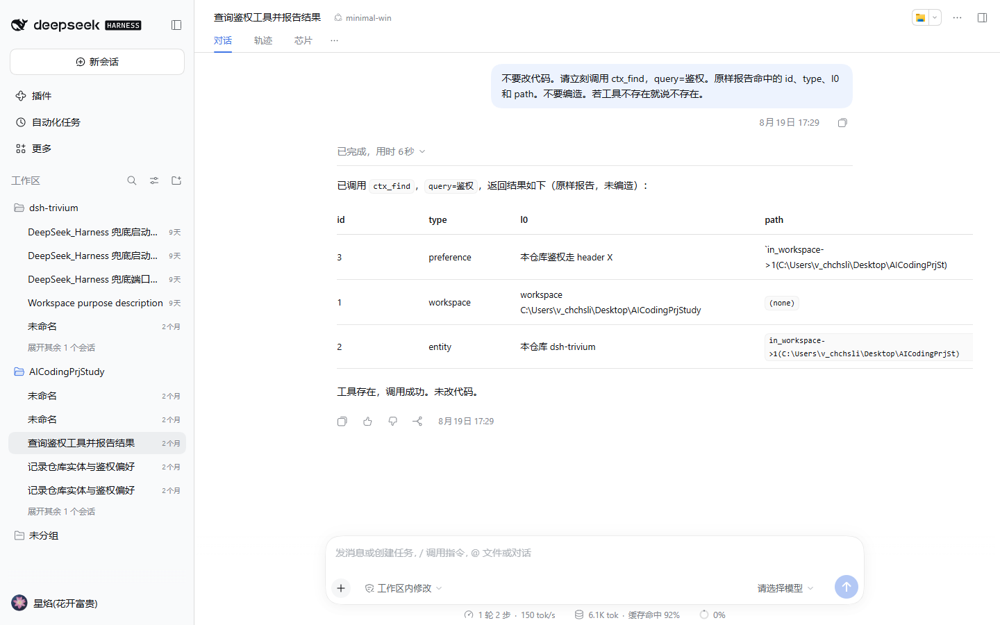
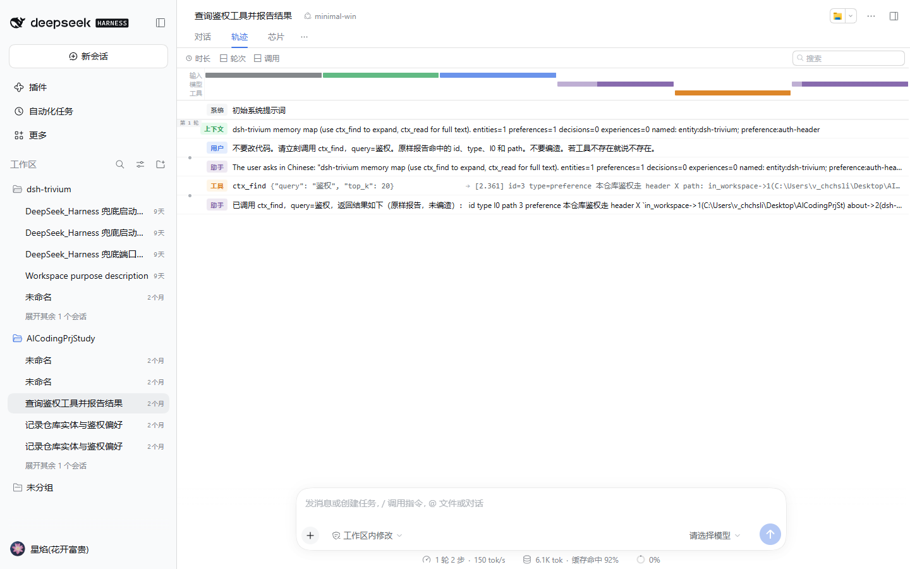
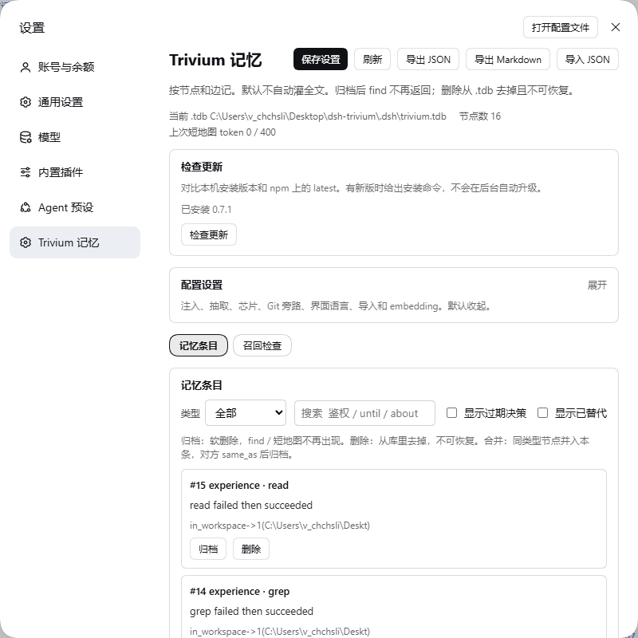
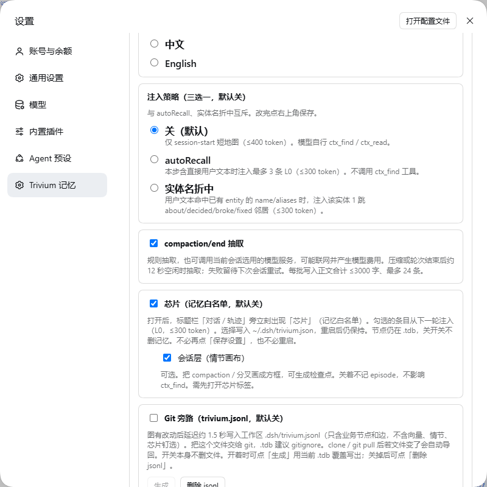
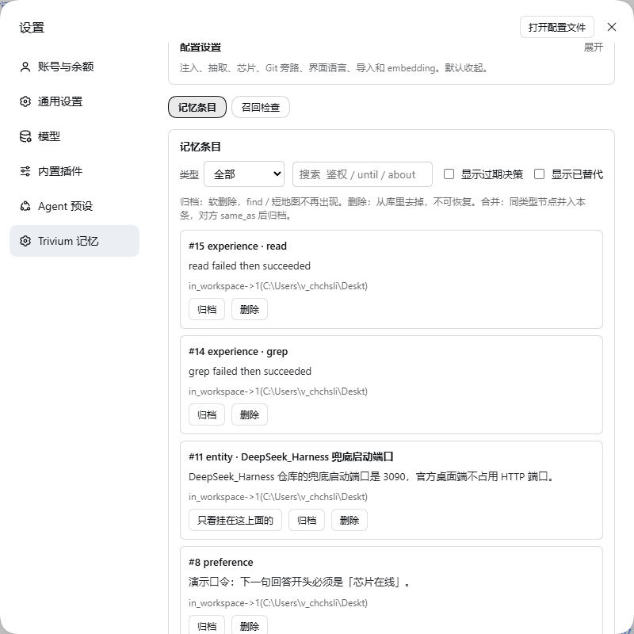
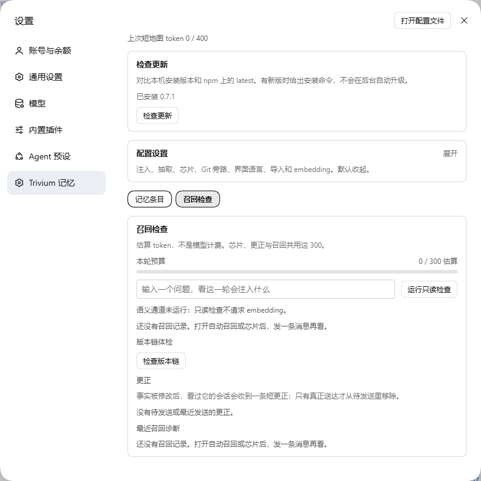
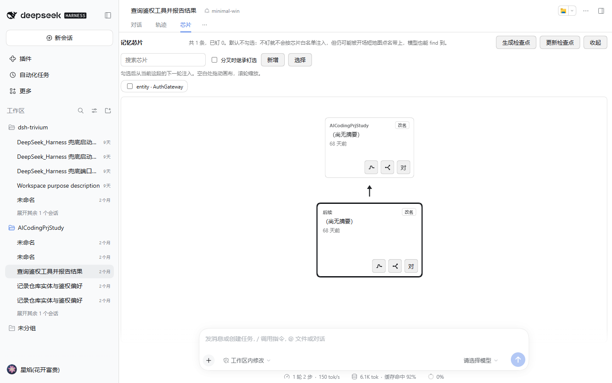

# dsh-trivium — In-process graph memory for DeepSeek Harness

<p align="center">
  
</p>

In-process graph memory for DeepSeek Harness. One `.tdb` per workspace. No extra server.

The kernel stays close to DSH: no extra process, no extra nav by default. Pin memory fragments with optional chip inject; the plot canvas is an optional extra, loaded from Settings.

> **Quick install**: `dsh plugin --profile web add dsh-trivium` → restart **dsh web** → open a workspace (Settings shows **Trivium memory**; the **Chips** tab stays off until you turn it on). Details in [Installation](#installation).

[**English**](README.md) | [中文版](README.zh-CN.md)

---

## Installation

> Prerequisite: install [DeepSeek Harness](https://github.com/deepseek-ai/deepseek-harness) and start `dsh web` at least once. Current Web verification uses `0.2.1-rc.4`; see the [baseline and evidence index](docs/README.md) for desktop `0.2.1-rc.3` coverage and limitations. Node must satisfy `^22.19.0 || >=24`; `triviumdb` is pinned to `0.9.0-beta.3`.

```sh
dsh plugin --profile web add dsh-trivium
```

Restart **dsh web**. Memory lives in the current workspace:

```
<workspace>/.dsh/trivium.tdb      # local index (binary; gitignore this)
<workspace>/.dsh/trivium.jsonl    # optional Git exchange snapshot (business facts)
```

Commit `trivium.jsonl`. Ignore the binary store:

```gitignore
.dsh/trivium.tdb
.dsh/trivium.tdb*
.dsh/trivium-pending.json
```

Clone / `git pull` re-imports when the jsonl changed. Settings → **Git sidecar** is **off** by default (same as chips). Turn it on under **Settings** (the fold below Check for updates). The switch only starts or stops auto-write. **Generate** (while on) overwrites `.dsh/trivium.jsonl` from the current `.tdb` at the same path. **Delete jsonl** (while off) removes known workspace jsonl files (`.tdb` stays). Episodes, embeddings, and chip pins stay local.

If you launch DSH with [Dsh_BatStart](https://github.com/QWQcool/Dsh_BatStart), the plugin is installed for you — skip the command above.

Local source checkout:

```sh
npm install
node scripts/link-dsh.mjs
npm test              # optional: runs every offline smoke script
```

`npm test` needs no DSH host and never touches your real `~/.dsh/trivium.json` (each script gets its own temp settings file). Pass a substring to narrow it: `npm test -- p8`.

Then restart `dsh web`.

## Updating

Before upgrading, stop DSH and back up the entire workspace `.dsh/trivium.tdb*` file group. Default mmap storage also uses `.vec`, `.wal`, `.text`, and other sidecars. Git JSONL omits local-only data and is not a complete backup.

```sh
dsh plugin --profile web add dsh-trivium
```

Restart **dsh web**. For a source checkout, `git pull` then run `node scripts/link-dsh.mjs` again.

## Uninstall

Stop **dsh web** first so the `.tdb` is not locked, then:

```sh
dsh plugin --profile web remove dsh-trivium
```

`remove` deletes this plugin’s files: `~/.dsh/trivium.json`, and in every workspace the plugin has opened, `.dsh/trivium.tdb`, `trivium.jsonl`, and `trivium-pending.json`. Other files under `.dsh/` stay. Updating with `dsh plugin add dsh-trivium` does **not** wipe memory. If `trivium.jsonl` was committed, `git checkout` brings it back.

Restart **dsh web** afterward: Settings no longer shows **Trivium memory**, the title bar no longer shows **Chips**, and the four tools are unregistered.

Workspaces never opened after this version may still have an old `.tdb`; delete that file by hand if you find one. Disable without uninstall (data stays): in that profile’s `cordis.patch.yml` add:

```yaml
- id: dsh-trivium
  disabled: true
```

Then restart `dsh web`.

## Permissions and data

The plugin loads inside the `dsh web` process. It does not open its own port or extra service.

| Access | Default | Notes |
|---|---|---|
| Workspace `.dsh/trivium.tdb` | read/write | Memory store. Do not open the same file from two Node processes at once |
| Workspace `.dsh/trivium.jsonl` | read/write | Git sidecar (off by default). Business nodes/edges only; no embeddings |
| `~/.dsh/trivium.json` | read/write | Settings and chip pins; may contain an embedding API key you typed |
| `.dsh/trivium-pending.json` | read/write | Local queue when extract fails |
| Model extraction | on | When the host exposes a model service, extraction sends a bounded conversation excerpt to the current session's provider/model through DSH. A remote provider means network traffic and possible model charges. Without that service, extraction uses local rules |
| Remote embeddings | off | When enabled, node text and search queries are sent to the configured embedding URL. Keyword and graph retrieval work without it |
| Update check | manual | **Check for updates** fetches npm package metadata, without the conversation |
| Conversation excerpts | may be sent to the host model | Durable memory is stored locally. This does not make extraction or the DSH model conversation offline. Disable extraction and remote embeddings to stop those plugin-initiated model/embedding calls |

The official DeepSeek chat API has no embeddings endpoint. Keyword + graph walk still work without it. Restart `dsh web` after changing settings or embedding.

## AI-era installation

Copy this to your assistant:

```text
On DeepSeek Harness, run: dsh plugin --profile web add dsh-trivium
Then restart dsh web. Settings will show "Trivium memory". The title-bar tab is
"Chips" and is off by default; turn it on under Settings → Trivium memory
(Chips / memory whitelist). The toggle saves immediately; no second restart.
```

---

## Graph memory that stays quiet

Trivium is a memory kernel, not a journal, calendar, or chat companion. It stores **nodes and edges**, injects as little as possible, and lets you correct mistakes.

- **Cross-session graph** — session A stores “auth goes in header X”; session B calls `ctx_find("auth")` and gets the hit plus who it links to (`about` / `decided` / `broke` / `fixed`).
- **Default quiet** — a new session injects one short map (≤400 tokens). The model calls tools when it needs more. Nothing is dumped every step. No extra title-bar tab until you turn **Chips** on.
- **Chips / memory whitelist (off by default)** — Settings → Trivium memory. Toggle saves to `~/.dsh/trivium.json` immediately and survives restart. The title bar then shows **Chips** next to Conversation / Trajectory. Checked items pin into the next turn (L0, ≤300 tokens). Under it, **Session layer** (also off) draws compaction / forks as boxes.
- **Human-editable** — chips can add, archive, or delete; Settings search, rename, merge, import/export, and global switches.
- **Strict extraction** — chitchat, one-off file edits, and secrets are **not** auto-written from the transcript. Chip “Add” stores exactly what you typed (one paste = one node), still through the write hygiene gate.
- **Write hygiene** — `ctx_remember`, chip add, extract, and external import refuse mojibake, stutter loops, JSON envelopes, base64 residue, and secrets. Dirty nodes already in `.tdb` stay visible in Settings so you can archive them; they are hidden from find / short map / chips.
- **Optional embedding** — off by default. The official DeepSeek chat API has no embeddings endpoint; fill an OpenAI-compatible URL if you want one. Keyword + graph walk still work without it.

### Under the hood

- **In-process, one file** — TriviumDB (vectors + JSON payload + directed weighted graph) opens with the DSH process. No sidecar HTTP/Python service.
- **Four tools only** — `ctx_find` / `ctx_read` / `ctx_remember` / `ctx_link`. Chips / session layer do not add a fifth.
- **Injection via `agent.inject()`** — not the system prompt, so `persona.complete: true` cannot silently drop the map.
- **Recall carries paths** — every hit says which node it came from and along which edge.
- **Failures never block the agent** — store / embedding / extract errors are logged; the main loop continues.
- **UI follows the host language** — Settings and the Chips (memory whitelist) tab switch with DSH `locale/change` (`zh` / `en`). Any other resolved host language — and a browser that names no registered language — falls to English, the same `FALLBACK_LOCALE` the host itself uses.
- **First-turn map** — the short map is injected once per session. If `session-start` loses a race with the first model step, `pre-step` fills it in; it is not rewritten every step (prefix-cache friendly).

## Features

### Cross-session graph

Nodes are `entity` / `preference` / `decision` / `experience`. Business edges are `about`, `decided`, `broke`, `fixed`.

`ctx_find` returns L0 summaries plus edge paths (incoming as `<-label-id`). Entity-name queries also return `about` / `decided` / `broke` / `fixed` neighbors even when their text omits the query. Relevant expired decisions remain searchable as history, labeled `stale` and ranked lower. Set `include_stale: false` to exclude them. Automatic recall and the opening map still exclude expired decisions.

Dates in prose stay in prose. Set expiry in Settings or the separate `ctx_remember.until` field. Supported labels are `YYYY-MM-DD`, weekdays such as `Friday` / `周五`, `周末`, and `下周` (one week), resolved at the end of the UTC day. An unresolvable replacement label cannot retain the old `untilAt`. Clearing the label clears the timestamp; changing a relative deadline anchors it to the edit, while saving an unchanged label does not extend it.

0.4.22 does not bulk-delete existing expiry fields. Find affected entries with `ctx_find` or Settings → **Show expired decisions**, clear `until`, and save. Later edits to dated prose will not recreate the expiry.

### Chips (memory whitelist)

Off by default. In Settings, turn on **Chips (memory whitelist)** — no extra Save click, no restart. The title bar shows **Conversation / Trajectory / Chips** at once, and the choice is stored in `~/.dsh/trivium.json` so it survives restart. This is a pin whitelist, not the memory editor. Rename, merge, and global switches stay on the Settings page.

Lists unarchived preference / decision / entity (experience stays out). Check to pin into the next turn (L0, ≤300 tokens). Add / archive / delete on the strip.

| Action | When it takes effect |
|---|---|
| Check a chip | The **next** message you send in this segment carries it (L0; chips and recall share 300 tokens) |
| Uncheck | The turn after that no longer carries it |
| Add | One click writes one node; a whole paste is still one node |
| Select → Archive | Soft delete: gone from find / short map / chips; the node remains in `.tdb` |
| Select → Delete | Removed from `.tdb`, not recoverable |
| Turns already sent | Not rewritten |

Chips are per session. New sessions and forked children start unchecked. Inherit pins when the session layer fork dialog is on, or check them again on the child. The short map still arrives at session-start and does not use a chip slot.

**Session layer** is a nested switch, also off. When on, the same tab draws compaction / fork boxes (Create checkpoint, Update checkpoints, fork from a box). Episode nodes are not recalled by `ctx_find`. Turning the layer off stops writing episodes; existing `.tdb` nodes stay.

### Settings (Trivium memory)

Settings → **Trivium memory** manages the store. Check for updates sits at the top; **memory entries** stay visible. Everything else is inside a **Settings** fold (collapsed by default): injection, extract, chips, Git sidecar, plugin language, import, embedding. Toggles write `~/.dsh/trivium.json` as soon as you flip them.

| Switch | Default | What it does |
|---|---|---|
| **Chips (memory whitelist)** | off | Title-bar **Chips** tab next to Conversation / Trajectory. Checked chips are a whitelist for the next turn (L0, ≤300 tokens). |
| **Session layer** | off (needs Chips on) | Plot canvas on the same tab: Create checkpoint, Update checkpoints, fork from a box. |
| **Git sidecar** | off | Debounced write of `.dsh/trivium.jsonl` (format v2; relations included, local sources never written). **Generate** (on) overwrites from the current `.tdb`. **Delete jsonl** (off) removes known files. Clone / pull re-imports. |
| **Plugin language** | follow host | Chinese / English for this plugin's Settings card and Chips tab only. Does not change DSH. |
| **Injection** | off | Short map only, unless you pick autoRecall or entity-name path. |
| **Extract** | on | Write from compaction / idle. |
| **Embedding** | off | Needs **Save** plus a URL; restart after changing the URL. |

Injection detail: autoRecall injects at most 3 L0 hits when the step has user text; entity-name path injects 1-hop business neighbors only when the utterance names an existing entity. Corrections for delivered facts take priority, followed by checked chips and recall, all within the same allowance. Disabled injection or insufficient budget keeps notices pending with a reason; delivery on the next message is not guaranteed. Later pre-steps detect expiry of delivered decisions; there is no background timer and the ledger clears on restart. Extract runs after `compaction/end` and a short idle; failures go to pending and replay on the next session-start (body ≤3000 chars, at most 24 items).

- **Entries** — search, filter by type, expand business-edge neighbors, “only nodes hanging on this one”, hide expired decisions by default. Rename / edit body / aliases / until, merge same type, archive or delete.
- **Export / import** — JSON is a real round-trip. Markdown is a read-only projection (for people). Git sync uses `.dsh/trivium.jsonl` (business facts, auto). One-shot strict import from WorkBuddy `MEMORY.md`, Claude Code `CLAUDE.md`, and Codex `AGENTS.md`. No watch of those files, no session jsonl dumps.
- **Check for updates** — Settings compares the installed version with npm latest and shows `dsh plugin --profile web add dsh-trivium` when a newer version exists. It does not auto-upgrade.

### Sources, history, and recall check

The card has two tabs, and a node detail has three.

| Surface | What it answers |
|---|---|
| **Memory entries** | What is stored. Replaced versions are hidden by default; **Show replaced** is a separate switch from **Show expired**. |
| **Recall check** | What the last turn actually injected, in estimated tokens, plus a read-only probe: candidates, real filter reasons, and the exact text that would be sent. |
| **Content / Source / Decision history** | The body, where it came from, and the chain of decisions that replaced it. |

A memory knows where it came from only if the write recorded it (`kind`, session, message, a short quote). A record with no source says so; it never guesses a session or an author. A session this process cannot confirm is reported as unavailable while the stored excerpt is kept. The host exposes no session locator, so there is no deep link — rather than inventing one.

The recall check is read-only: it does not write, does not run a tool, and never requests an embedding. With no query vector it says the semantic channel did not run. Nothing on these tabs injects context or calls a model.

### Replacing a decision

A newer decision does not expire the old one — it supersedes it. **Replace…** on a decision picks another existing decision, shows both side by side, and asks for confirmation. The old body and deadline are kept and nothing is archived; the panel then shows **Current version** / **Replaced** as its own axis, next to **Expired**.

The chain is linear: at most one direct predecessor and one successor, no cycles, at most 32 hops. Writes are validated server-side inside a per-workspace queue with both nodes' ETags, so a second window that confirmed off a stale view gets a 409 instead of overwriting. **Undo replacement** removes only that one relation, and it refuses when a newer version sits above it.

A body inside a chain is confirmed history: automatic extraction, merging, editing the text, deleting or merging the node are all refused (`REVISION_PROTECTED` / `REVISION_LINKED`). Name, aliases, deadline and source notes stay editable. New text becomes a new decision that then supersedes the old one.

Automatic recall still only speaks about the current version: a hit on an old body is mapped forward, de-duplicated, and carries one short `matched_history` pointer. A pin you set on the old version is never rewritten — it is marked historical with an offer to pin the current version. If the current version is archived or expired, the chain is simply not injected; the old version is not revived.

### Agent tools

| Tool | What it does |
|---|---|
| `ctx_find` | Text / optional vector / graph search; L0 summaries and paths. Expired history is labeled `stale` and ranked lower; `include_stale: false` excludes it |
| `ctx_read` | Full text and incoming edges by id |
| `ctx_remember` | Manual write; optional explicit `until` field for real expiry, never inferred from dates in prose |
| `ctx_link` | Directed edge between two nodes |

The kernel is still these four. Chips / session layer do not add a fifth tool.

---

## Screenshots

Captured on 2026-10-28 inside DSH Web `0.2.1-rc.4` with `dsh-trivium@0.7.1`, Chinese host UI. They are a UI tour, not acceptance evidence — versioned proof and current limits stay in the [documentation index](docs/README.md). The plugin follows the host language unless you pick Chinese / English under **Settings → Trivium memory → Configuration**.

### Conversation — `ctx_find("鉴权")`



Session-start injects the short map; the model calls `ctx_find` and hits “auth in this repo goes in header X”.

### Trajectory — injection is visible



### Settings — updates, language, injection



Check for updates sits above a collapsed **Configuration** fold (plugin language, injection strategy). Below it are the **Memory entries** and **Recall check** tabs.

### Settings — extract, chips, Git sidecar



Nested under chips: **Session layer (plot canvas)**. Git sidecar, Markdown export, one-shot external import, and remote embedding are on the same page.

### Settings — memory entries



Type filter, text search, and the **show stale** / **show superseded** toggles sit above the list; each card shows its own archive / delete actions.

### Settings — recall check



The **Recall check** tab shows this turn's estimated budget, a read-only dry run of one query, the revision-chain check, pending / sent corrections, and the latest recall diagnostics. Opening it or running the dry run does not call the model and does not request embeddings.

### Chips — optional, next to Conversation / Trajectory



Off by default. After you turn **Chips (memory whitelist)** on in Settings, the title bar shows **Chips** immediately. With **Session layer** also on, a never-compacted session has one “Next” box; chips sit on top (unchecked by default). **Create checkpoint** folds “Next” into a left box. After compaction or `/compact`, historical boxes appear on the left; forks leave a box toward a child session.

---

## Limitations

- If the model never calls `ctx_find` and no chips are checked, the window is mostly the opening short map.
- Extraction misses things; dirty data can be archived / deleted on the chip strip or edited / merged in Settings.
- Do not open the same `.tdb` from two Node processes at once (one `dsh web` is enough). The panel now says so instead of showing the raw TDB error.
- **Supported window width: 900 px and up.** At 390 px the host keeps a fixed 188 px settings sidebar, leaving ~154 px for the plugin column (~106 px cards); the layout collapses but is not readable. Phone-width support is intentionally not claimed.
- Markdown export is for humans; it cannot be parsed back. Git-friendly write-back is `trivium.jsonl`, not Markdown. External import (WorkBuddy / Claude Code / Codex) is one-shot, not two-way sync, and does not ingest session jsonl dumps.
- Do not merge `.tdb` in git (binary). Track `trivium.jsonl`; ignore `.tdb`. jsonl merge conflicts are ordinary text — resolve, then reopen the workspace.
- The session layer (when on) projects compaction and fork; it does not split boxes by message count. If the window has not reached DSH’s compact line, **Update checkpoints** will not invent history boxes — use **Create checkpoint**.
- Plugin setting toggles (chips / session layer / git sidecar / recall / extract) save immediately. Embedding URL still uses Save; restart only if the Settings card itself is missing.
- **0.5.0 writes JSONL `v: 2` and graph JSON `version: 2`.** Both are additive and a v1 file still reads, but downgrading is not supported in place: an older build ignores the revision relations and will drop them on its next write. To go back, restore the pre-upgrade file group (`.dsh/trivium.tdb` plus `.dsh/trivium.jsonl`) rather than letting the old build rewrite it.
- A decision chain is linear in this release: one predecessor, one successor. Splitting one version into several, or a fan-in, is refused instead of half-applied.
- Deleting a replacement relation from the JSONL file is reported as a conflict, not applied. Revoke it in the panel.
- After the host moved to rc.8, DSH’s own older session store may not open (official SQLite format change). The workspace `.tdb` graph is still there; leftover boxes on unmatched old sessions are plot residue and do not affect `ctx_find`.

---

## Changelog

**0.8.0** — Workspace switching, operation receipts, read-only import preview and per-turn delivery records. Fix exact-name recall, revision-confirmation bypass and damaged-chain projection. Extraction is single-flight, retryable after failure and wakes after cooldown; pure acknowledgements skip the model. Trim context/tool overhead without changing defaults or data formats. See [release notes](docs/release-0.8.0.md) for evaluation and cost limits.

**0.7.1** — Reliability fixes. JSON/JSONL share URI mapping, final-graph validation and a fact transaction; rejected input is preserved and recoverable, including archived revision history. Fix repeated corrections, clock-only expiry, stale projections and the 32-hop boundary. Corrections take priority within the existing shared budget; disabling injection still retains pending notices. Sidecar health and runtime diagnostics are scoped to the workspace. Settings requests stay bound to the displayed store; search races, keyboard expansion and nested dialogs are fixed. The deadline cleaner's dry run is now truly read-only. Data formats, four tools and defaults are unchanged. See the [release notes](docs/release-0.7.1.md).

**0.7.0** — Observability release. Settings → Recall check now lists pending and recently delivered corrections per session, scoped to the workspace, and adds a **Check version chains** button that runs the same read-only check as `dsh-trivium-check`. New read-only endpoints: `GET /api/dsh-trivium/corrections` and `GET /api/dsh-trivium/integrity`. A fault-injection regression now proves a sidecar write failure is reported by health and repaired by `bootstrap-write` on reopen, and the README documents the host-side desktop `EPIPE`. Memory format, defaults and the four-tool surface are unchanged.

**0.6.0** — Maintenance release. The read-only revision checker and the stale-deadline cleaner now ship with the package as `dsh-trivium-check` and `dsh-trivium-clear-until` (dry run by default; `--apply` clears only deadlines also present in the body, `--all` clears every stale one). The checker previously existed only in the Git checkout even though the 0.5.1 notes told users to run it. This release also pins two verifications: turn identity comes from the host's own user-message id (checked in a real session log), and a genuine second-window attempt with a stale ETag returns 409 and succeeds after refresh. No defaults or data formats changed.

**0.5.1** — Correctness release for 0.5.0. A user turn is now booked by the text actually rendered, so three long chips can no longer ship 3 × ~217 tokens against one 300 allowance; commit is idempotent and an explicit zero budget stays zero. Version resolution returns the current node's own body, type, deadline and state instead of only its id, so a query matching a superseded decision no longer shows the old instruction under the new id. Imports plan URI identity and validate the whole resulting graph before one native transaction: two versions are never merged by similar text, no `supersedes` self-loop is written, and a failed transaction leaves no node, body or edge behind. When a delivered fact changes, the session that saw it gets a short correction notice (never the old body), scoped per workspace and consumed only after delivery. Kernel: `triviumdb@0.9.0-beta.3` (pinned prerelease). Windows are supported from 900 px upward; at 390 px the host's 188 px settings sidebar leaves ~154 px for the panel, which is not readable (it does not scroll horizontally). Upgrade note: `until` values written by 0.4.21 from prose dates are not rewritten automatically — clear them with **Show expired decisions** or `ctx_remember` with `until: ""`.

**0.5.0** — Memory you can audit. Chips and recall now share **one** 300-token allowance per user turn instead of clipping to 300 each, the same node can no longer appear twice, and a tool loop no longer re-injects inside one turn. The delivery ledger is keyed by host message ids, so a failed send is retried and compaction rebuilds, while a fork inherits neither the ledger nor the pins. `ctx_find` is capped at ~1200 estimated tokens with whole-record truncation, and `ctx_read` projects a field allowlist so new metadata cannot grow its output.

Settings gains a **Recall check** tab (read-only: it never writes, runs a tool, or requests an embedding) and per-node **Source** / **Decision history** tabs. Provenance is reported only when a write recorded it — no invented sessions, quotes, or deep links. Recall traces name the pipeline branches that actually ran, capped at 20 per workspace+session / 10 minutes / 64 KiB each.

New `supersedes` relation between decisions, confirmed by the user: linear chain, 32-hop limit, per-workspace write queue, both endpoints' ETags, idempotent `operationId`, and a revoke that touches only that edge. Chain bodies are protected from extraction, merges, edits and deletes. JSON export is `version: 2` and the Git JSONL is `v: 2`; both are additive and v1 still reads, but v2 cannot be downgraded in place.

**0.4.22** — Fix [issue #3](https://github.com/QWQcool/dsh-trivium/issues/3): expiry is explicit, clearing it persists, and relevant expired history is searchable with a `stale` label. Preserve native text/vector candidates; add multiword fallback, aliases, and two-character Chinese entity anchors. Upgrade TriviumDB to `0.8.11`. Add focused expiry/recall regressions and keep automatic recall restricted to unexpired memories.

The peer ranges now explicitly admit the supported DSH `0.1.5`, `0.2.0`, and `0.2.1` RC lines; a broad stable-version range alone does not include those prereleases under npm rules.

**0.4.21** — Host adaptation for `@deepseek-ai/dsh@0.2.x`. Session format v4 replaced the shared `kind: "plugin"` message source with producer-owned kinds: a third-party producer must write `kind: "plugin:dsh-trivium"` and drop the `plugin` field, or the whole turn fails with "format v4 message requires a producer-owned source kind". The plugin now picks the shape from the installed `dsh-llm` version, so 0.1.x keeps working. `agent/created` (0.1.6+) is handled next to `agent/session-start`, with a one-shot guard in case a host emits both. Peer range widened to `<0.3.0`. New `smoke-p14` pins both source shapes and the version switch. Four tools / short map / find paths unchanged.

**0.4.20** — Storage bump to `triviumdb@0.8.9`. The napi surface is unchanged (`triviumdb.d.ts` and `index.js` hash identically to 0.8.8), so this is a kernel-only update: SM-L2 is now the default QuIVer query path, FIND planning no longer materializes discarded candidates, and the server edition ships an attributed Web Console. All 14 offline smoke scripts pass unchanged. Four tools / short map / find paths unchanged.

**0.4.19** — Fixed the plugin's own UI rendering Simplified Chinese on an English host ([issue #2](https://github.com/QWQcool/dsh-trivium/issues/2)). The `locale` service is now reached through `ctx.inject(["locale"], …)`, so **follow host** no longer depends on composition order, and the plugin fallback is `en` — the host's own `FALLBACK_LOCALE`, and the bucket every other resolved host language lands in. The Settings card and the Chips tab only ever choose between zh and en, so a browser naming no registered language no longer gets a Chinese card. Four tools / short map / find paths unchanged.

**0.4.18** — `~/.dsh/trivium.json` is now written atomically (a truncated write used to reset every switch and chip pin silently) and is owner-only on POSIX. `npm test` runs every offline smoke script with isolated settings, and `smoke-p0` pins the hybrid text-index-after-reopen invariant. Four tools / short map / find paths unchanged.

**0.4.17** — Storage bump to `triviumdb@0.8.8` (engine behavior unchanged from 0.4.16). Host adaptation for `@deepseek-ai/dsh@0.1.5-rc.1`: `session.header.seedLength` was removed, so the session-layer fork cut now reads `session.inheritedEventCount`. Four tools / short map / find paths unchanged.

**0.4.16** — Storage bump to `triviumdb@0.8.4`: the engine constructor now takes an options object (`{ dim }`) instead of numeric positional args, and TQL rows return string ids that the plugin coerces back to numbers. Four tools / short map / find paths unchanged.

**0.4.15** — Storage bump to `triviumdb@0.8.2`. The settings API rejects non-loopback requests and unlisted `cwd` values; the extract buffer is cleared after a run and `savePending` no longer blocks the turn.

**0.4.14** — Storage bump to `triviumdb@0.8.1` (harder WAL/locks, optional read-only share, ARM64 fixes). Four tools / short map / find paths unchanged.

**0.4.13** — Title-bar tab is **Chips** (short); the Settings switch stays **Chips (memory whitelist)**. Toggling the session layer refreshes the Chips tab immediately. Settings / Chips screenshots updated.

**0.4.12** — Git sidecar: workspace `.dsh/trivium.jsonl` is the text source of truth (business nodes and edges). `.tdb` stays the local index. Writes are debounced (~1.5s), no extra model calls. Clone / `git pull` re-imports when the file changed. Switch is **off** by default. **Generate** overwrites jsonl from the current `.tdb`; **Delete jsonl** (switch off) removes known files. Settings folds optional config below Check for updates. Plugin language can follow the host or lock zh/en.

**0.4.11** — Title-bar tab is **Chips (memory whitelist)** (was Session graph). The switch persists to `~/.dsh/trivium.json` as soon as it is toggled; the tab appears or disappears immediately, no restart.

**0.4.10** — `dsh plugin remove` deletes known workspace `.tdb` files and `~/.dsh/trivium.json`. Plugin update does not wipe. Disable-in-place still keeps data.

**0.4.9** — Chips tab and session-layer canvas are both off by default. Title bar shows **Chips** only after the Settings switch; session boxes sit under that switch. Kernel (four tools, short map, in-process `.tdb`) unchanged.

**0.4.8** — Write + inject hygiene gate (secrets, mojibake, stutter, JSON envelopes, base64 residue). Settings / Chips tab follow DSH language. Settings can check npm for updates. One-shot strict import also discovers Claude Code `CLAUDE.md` and Codex `AGENTS.md`. First-turn short map is guaranteed if `session-start` races the first step.

**0.4.7** — Storage bump to `triviumdb@0.7.6` (`searchExact` / `searchBatch` on the engine). find / Chips tab behavior unchanged.

**0.4.6** — Chips tab **Create checkpoint**: fold the current “Next” into a left box. Does not trigger DSH compaction.

**0.4.5** — Host peers widened to `0.1.0-rc.8` and `0.1.1-rc.2`; no nested old `dsh-llm` / `dsh-tools`.

**0.4.4** — `triviumdb@0.7.5`: incoming edges, expand-by-label, delete-by-label go through engine APIs instead of scanning all edges. find / Chips tab behavior unchanged.

**0.4.3** — Chips tab **Update checkpoints**: backfill DSH compression markers and sidebar forks for sessions that existed before the plugin. Never-compacted sessions still have only “Next”.

**0.4.2** — Chip strip can add (one paste = one node) and batch archive / delete. Auto-extract stays strict; chip add writes what you typed.

**0.4.1** — Host pinned to `@deepseek-ai/dsh@0.1.0-rc.8`. Same features as 0.4.0. Confirmed on rc.8: Settings “Trivium memory”, new-session short map, cross-session `ctx_find`, title-bar tab (now Chips).

**0.4.0** — Title-bar tab, memory chips, fork from a checkpoint.

## Troubleshooting

| Symptom | What to do |
|---|---|
| Settings has no **Trivium memory** | Confirm the **web** profile, then **restart** `dsh web` and open a workspace. Reloading the browser is not enough. |
| Settings card / Chips tab shows Chinese on an English host | Fixed in 0.4.19 ([issue #2](https://github.com/QWQcool/dsh-trivium/issues/2)). On an older build pick **Settings → Trivium memory → Settings → Plugin language → English**; that is stored in `~/.dsh/trivium.json` and a page reload is enough (no host restart). |
| Title bar has no **Chips** | Turn on **Chips (memory whitelist)** in Settings (it saves as soon as you toggle). Switch back to the conversation; the tab should appear without restarting. |
| Injection / extract / embedding / chip tab changes have no effect | Chip / extract / recall toggles save immediately. Embedding URL still uses **Save**. Restart `dsh web` only if the settings page itself is missing. |
| Session layer shows only a **Next** box | Expected when the nested session layer is on. Boxes follow DSH compaction; a long session is not the same as already compacted (auto-compact is around 80% of the window). To split: `/compact` in the conversation, or **Create checkpoint** (plot only, does not compact the window). Older sessions can use **Update checkpoints** to backfill past compaction / forks. |
| `ctx_find` returns nothing | A new session injects the short map only; the model must call the tool. You can also **Add** on the chip strip or tell the model “remember: …”. Chitchat and one-off file edits are not auto-written. |
| `.tdb` is locked / will not open | Run one `dsh web`. Do not run two Node processes that both linked this plugin. |
| Embedding is filled but search is no more accurate | Failures fall back to keyword + graph. Check that `~/.dsh/trivium.json` has an OpenAI-compatible URL (the `/v1` kind). Restart after changing it. |
| Memory still there after uninstall | Stop `dsh web` before `dsh plugin remove`. Leftover `.tdb` is a workspace never opened on 0.4.10+; delete `.dsh/trivium.tdb` in that folder. Committed `trivium.jsonl` comes back with `git checkout`. Disable-in-place does not wipe. |
| Check for updates fails | That request only hits the npm registry for the latest version. Memory is unaffected; try again later. |
| Old conversations will not open after rc.8 | That is DSH’s own session-store format change, not a broken `.tdb`. Graph memory still works via `ctx_find`; leftover boxes on unmatched old sessions are plot residue. |
| Desktop shows “A JavaScript error occurred in the main process” with `EPIPE: broken pipe, write` | Host-side, not the plugin: `electron-updater` writes a log line to a console pipe whose parent process has exited (typical when the app was started by a test launcher with `--inspect`). No `dsh-trivium` frame is in that stack. Click OK and start the app from the Start menu; avoid launching it from a terminal or harness that closes. |

**Maintenance commands** (shipped with the package since 0.6.0):

- `npx dsh-trivium-check <workspace>` — opens the graph **read-only** and reports `supersedes` self loops, cycles, forks, duplicate URIs, dangling endpoints and unresolvable chains. Exit code 0 clean, 2 issues, 1 cannot open.
- `npx dsh-trivium-clear-until <workspace>` — dry run: lists stale decisions that still carry a deadline. `--apply` clears only deadlines whose text also appears in the body (the shape 0.4.21 produced from prose dates); `--apply --all` clears every stale deadline, including explicit ones. Close the host first — the kernel is single-writer.

Local source checkout: `npm install`, then `node scripts/link-dsh.mjs`, then restart `dsh web`. `triviumdb` is a native module; if it will not install, check Node against `package.json` `engines` (`^22.19.0 || >=24`).

---

## Release info

- GitHub: https://github.com/QWQcool/dsh-trivium
- Package version: `0.8.0` · [npm](https://www.npmjs.com/package/dsh-trivium)
- Tested host: `@deepseek-ai/dsh@0.2.1-rc.4` (the peer range also admits the 0.1.x lines)
- License: MIT (depends on [TriviumDB](https://github.com/YoKONCy/TriviumDB), Apache-2.0)

---

## Acknowledgements

Parts of the write hygiene gate, npm update check, host-locale UI switching, and Claude Code / Codex file discovery were adapted from [dsh-auto-memory](https://github.com/Aik358/dsh-auto-memory) (Aik358). The product stays a graph kernel (nodes, edges, four tools, quiet default) rather than a journal / calendar companion.
