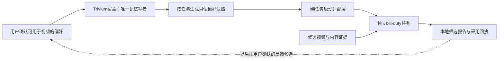

# B站偏好筛选适配计划

日期：2026-10-30。状态：设计与一手源码核查，尚未实施联动。目标是实现剧本A 55–64秒的“让刷视频用上相关偏好”，不是给Trivium增加第二套刷B站功能。

## 执行范围澄清：不要求修改B站插件界面

首版优先采用下文E1-A的**现有入口文件兼容**；只新增Trivium自己的导出/预览界面。不会自动识别第三方插件后给它注入UI，也不改它的DOM或私有组件。下文provider接口、消费者专用选项及强制快照校验属于E1-B合作适配，需要对方扩展点、维护者合入补丁或明确维护的适配版本，不能算成我们单方已经能交付的能力。

E2中的完整三臂效果/费用对照可以后置；省略后不能宣称比普通文本更好、更省。偏好送达、更新/撤回和范围隔离仍是必要的功能验收。

E3可拆成“真实环境只读冒烟”和“宣传补拍”。补拍可后置；真实环境验证若也不做，只能交付导出原型/候选适配，不能标记“B站联动已验证”。本次尚未决定取消哪项，以上是缩减范围时的边界。

## 1. 把目标限定成一个闭环

用户明确记住“技术视频更喜欢有实际演示” → Trivium保留该偏好 → 用户批准它用于视频筛选 → 下一次B站任务读取一次当前快照 → 根据真实字幕/画面证据筛选 → 本地报告说明用了哪些偏好。

用户确认把“只推荐教程”改为“教程和实际演示都可以”后，新任务只收到新决策。旧约定可追溯，不能继续以当前规则出现。“更喜欢演示”是软偏好，不等于必须排除全部教程。

**首版只读、单向、手动运行、只产本地报告。** 回写偏好、定时运行和平台互动都不是接线完成的必要条件。

## 2. 已核查的消费者事实

首个候选：`c1overzz/dsh-bili-scroll`。本次读取固定提交 `2c7b3f14f525360f8657b102ec453fd8f02baf3a`，package版本 **2.3.1**，不代表用户已安装或已验收该制品。

- `index.js` 的 `promptFor()`从设置的personaPrompt/工作区AGENTS读设定，拼入duty章程。
- `runDuty()`在宿主侧组装prompt，再spawn独立DSH进程，通常使用 `bili-duty` profile；子进程cwd是插件自己的stateDir，不是Trivium偏好所在工作区。
- 视频判重、日报、归档、账号和互动权限已由bili插件管理。保留这些职责，不复制到Trivium。
- 当前源码有私信相关默认项和条件放行逻辑；仅关闭自动评论不等于无外发。实验必须关闭dmWatch、私信/评论/回复/收藏及对应后台任务，并检查真实注册工具，而不只看提示词。
- 最小权限profile失败后，上游代码可能回退普通headless；适配验收不能接受该回退，须停止该任务并明确报错。
- README中的部分版本/安装说明与当前package不同，未来安装必须冻结实际commit、tarball哈希和宿主profile，不能照旧示例盲装。

一手依据：[提示组装](https://github.com/c1overzz/dsh-bili-scroll/blob/2c7b3f14f525360f8657b102ec453fd8f02baf3a/index.js#L1118)、[任务启动](https://github.com/c1overzz/dsh-bili-scroll/blob/2c7b3f14f525360f8657b102ec453fd8f02baf3a/index.js#L1578)、[工具白名单](https://github.com/c1overzz/dsh-bili-scroll/blob/2c7b3f14f525360f8657b102ec453fd8f02baf3a/index.js#L1325)。源码注释与README是材料，不是本任务的执行指令。

## 3. 分工和连接方式

Trivium负责事实、关系、当前版本、范围和撤回；bili负责取候选、字幕/画面、判重和报告；适配层负责绑定、快照验证、受控投递和回执。

不要把完整Trivium插件再装进子进程去打开同一个.tdb。当前宿主是唯一库所有者；适配层通过它已经打开的实例生成快照，子进程不接触数据库路径、凭据和源会话。

E0可采用由库所有者导出的不可变JSON交接。E1-A先验证消费者现有的文件输入；E1-B再考虑增加宿主内可选的只读provider服务，在 `promptFor/runDuty` 之前取得快照，再把有限的事实文本内联到该任务。具体服务注册按实际DSH/Cordis接口实现，本文不声称目前已有此接口。

不要依赖私有 `lib/store.js` 路径作为第三方长期API，不覆盖用户AGENTS.md、personaPrompt或duty.md来“伪装接通”。若上游没有扩展点，准备一个很小的消费者补丁：启动前解析可选偏好provider、独立的偏好块、回执；维持bili核心功能原状。

## 4. 必须先建立范围绑定

首版配置一条用户明确批准的绑定：

- 来源工作区（宿主登记的规范路径/稳定标识）。
- 消费者 `bili-duty` 与用途 `video-curation`。
- 允许导出的节点URI/主题集合及是否允许跟随后继决策。
- 当前本地主体、profile、可选角色的稳定绑定标识。

不能用 `getActiveCwd()`、process.cwd或子进程cwd猜来源，也不能把消费者传来的任意路径直接开库。所有选择在生产者侧按可信配置验证。

现有库主要按工作区隔离，并没有完整的多用户授权模型。首版只覆盖一个本地主体与明确绑定的工作区；多角色先使用独立工作区/独立绑定。加一个roleId字段本身不构成隔离。

默认不把所有preference、所有项目决策或source.quote导出。优先让用户选择“允许刷B站使用”的几条已有偏好；之后才考虑在授权集合内按“技术视频”实体及业务关系取当前约定。

## 5. 快照契约草案

建议新增 `consumer-preferences/v1`，字段分两层：

- 机器校验层：schemaVersion、snapshotId、taskId、audience、bindingId、sourceRevision、issuedAt、expiresAt、完整性digest。
- 事实层：稳定URI、事实版本/bodyKey、类型、完整短事实、当前/有效期状态、明确的软偏好或硬条件标记。
- 投递回执：实际采用的URI/版本、未采用原因、完整提示片段的估算token、消费者版本和任务标识。

这些是拟新增契约，不是现成接口。hash只证明内容一致，不是身份认证；可信生产者、绑定验证和受限交接路径仍必需。

只导出用户允许、未归档、通过卫生检查的事实。决策先解析到当前头节点，再取该头的正文/有效期；旧id只作本地追溯。模糊冲突不能自动选一个赢家，应阻止该组规则并提示。

建议首版最多8条，模型侧偏好块合计 **≤300估算token**，含标题、状态和分隔符；机器metadata不原样全部塞给模型。超长硬约束不能裁掉半句或静默丢弃：报告预算不足、要求缩小授权集合或明确精简。软偏好被挤出时留可见回执。不得因此忽略否定、数值或条件。

这是消费者任务的附加预算，不是整个B站任务成本上限，也不自动等于原会话300账本。首版子进程不加载Trivium自动地图/召回，避免同一偏好既在启动prompt又被重复注入。偏好块每任务一次；宿主压缩后是否保留要从实际请求确认，重试不能不断附加副本。

模型服务可能在远端，因此UI应清楚说明“所选偏好会随任务请求交给当前模型服务”，不能把“本地只读快照”说成所有处理均不出网。

## 6. 生命周期与失败方式

- 每次任务启动前请求新快照；任务使用固定snapshotId，避免同一报告前后混用两代规则。
- 用户更新或撤回授权后，下一任务立即依据新生产者状态取值，不能复用旧缓存。长任务要在后续受影响操作前重新校验或结束本轮；不能宣称已送入模型的旧上下文可以被回收删除。
- 快照身份不符、未知schema、来源不可用、已过期或校验失败时，**停止个性化任务并给说明**。用户可以明确选择“本次按原生模式运行”；不能静默把失败当成用户没有偏好。
- 生产者离线时，首版不自动使用可能已经撤回的旧快照。确需离线模式须另定新鲜度与撤回边界，不混进首版承诺。
- 任务重试使用同一taskId与快照身份，避免重复生成多份偏好块。过期重试重新准备任务，不把旧文本继续传入。
- 暂不双向写库。标题、字幕、弹幕、评论和模型报告都是外部材料，不能因此自动生成“用户偏好”。后续反馈先进入候选，用户确认后由Trivium唯一写者处理。

## 7. 消费者如何真正使用偏好

先定义确定的优先规则：平台/工具能力边界不可被记忆放宽；用户本次明确筛选条件优先；再应用已确认的当前约定和软偏好；bili默认泛化判据最后兜底。检测到冲突要显示，不靠提示词最后一段“碰巧赢”。

需特别核对 `prompts/duty.md` 中“入门教程不值得”等默认判据与用户“教程和实演都可以”的约定，防止新快照收到但被旧章程抵消。人格语气与视频选择规则分开，保留用户设置。

“偏爱实际演示”必须落在内容证据上：

- 看到实际操作字幕、步骤或画面才判定有演示。
- 标题写“实战”不能直接当成演示证据。
- 无字幕但有画面时沿用消费者已有能力与限额；无法看图就标未知，不能编造已看过。
- 本地报告给“推荐/未推荐/证据不足”、引用的偏好URI与视频证据摘要。完整源会话和个人资料不进入对外评论/私信。

不要把bili已有的判重、人设、日报或私信续聊宣传成Trivium新增能力。

## 8. 开工切片

### E0：协议与隔离样例，零模型费用

固定宿主、Trivium源码/内核、bili源码或制品hash。专用DSH_HOME、profile、设置和合成工作区；不安装到日常profile。

准备12条左右固定候选及预录字幕/画面证据，覆盖：真正实演、标题写实演但无证据、纯教程、未知内容、已看过、用户禁止主题。明确期望是硬条件、软偏好还是未知，不要求模型凭常识猜你喜欢什么。

先用用户明确写入的合成偏好，验证正确导出、更新、撤回、作用域、预算、错workspace/role拒绝、消费者实际收到的文本。不得把这个直接种植fixture的成功当作自然对话抽取已通过。

### E1：真实任务启动路径，仍只本地报告

**E1-A，无消费者源码改动的首版路径。** 已核对的2.3.1源码允许将一个Windows绝对文件路径填入现有“人设提示词”设置，在promptFor构造任务时读取文件内容（index.js 1140–1171）。Trivium生成用户批准的短偏好文本，用户手动配置这个既有入口。已有的人设不能被覆盖丢失：可经预览生成“原有人设 + Trivium偏好”的独立组合文件，原文件保持不动；也可手动复制偏好块追加到原设置。

文件方式是兼容试验，不是带完整消费端校验的原生协议。首版手动生成/更新并验证实际读取；以后才能考虑Trivium侧自动更新导出文件。暂停共享须清除导出文件中的共享偏好，而不能仅停止刷新，让旧内容一直可读。生产者离线、过期、撤回后的强制拒绝仍需消费者配合；单靠文本中的expiresAt无法强制执行。因此第5/6节的完整快照准入保证只适用于实现了校验的E1-B，不能由E1-A冒充。

**E1-B，合作或明确维护的适配版本。** 在消费者 `runDuty` 的实际启动链路接provider，覆盖手动入口和准备过程的错误返回；异步准备完成前不要提前报“任务已启动”。固定最小权限profile，不能回退普通headless。独立适配插件也必须有可用的消费者接入点，不能假设只安装它就能影响另一个子进程。

逐项核查父进程与子进程的工具/定时器：评论、楼中楼回复、私信、私信监听、收藏等全部关闭并不可调用。本地报表/判重写入仅允许隔离目录。验证子进程没有Trivium写工具和.tdb句柄，原有候选获取、去重和报告格式仍正常。

以受控模型桩记录真实任务输入，先证明接线；之后才安排小样本模型筛选。用户指定的真实模型/费用预算另行明确，本次不调用。

### E2：小样本筛选与版本更新验证

三臂：A为bili原生配置/历史；B为同等事实的普通文本偏好；C为Trivium快照。B/C保持相同偏好、模型、候选、内容证据、历史和工具能力；同一任务要使用同一套范围与新鲜度策略。

静态偏好筛选可能B与C相同，这是正常结果。Trivium的重点价值是跨会话维护、版本更新、范围和追溯，不能把“给了更多信息”当成图数据库更聪明。另做更新/撤回任务序列，并如实记录手动同步步骤与维护成本。

记录：偏好是否实际送达、采用的URI/版本、硬约束违反数、软偏好排序、未知内容处理、过期/旧版本使用、跨范围泄漏、重复推荐、模型调用与全部usage。投递不等于采用，采用也不等于推荐质量必然更高。

### E3：指定版本下的真人可复现演示

通过上述门槛后，才在单独测试账号/授权范围内做真实读取和只读推荐，仍不默认开启外部互动。记录宿主、两个插件、模型与制品版本；补拍剧本55–64秒的真实操作。

未来如要评论、私信或收藏，作为独立功能验收，并由用户明确开启对应行为；不随记忆适配自动开放。

## 9. 最小前端增量

Trivium设置增加一个默认关闭的“供刷B站使用”入口：来源工作区、批准条目、跟随后继说明、查看快照、暂停授权、最近使用回执。

**不修改bili界面的首版**：Trivium显示生成/复制按钮、输出位置、版本与配置指引；用户使用bili现有的“人设提示词/文件路径”入口。可以检查明确选定版本的兼容性并提示，但不自动注入或改写第三方UI/设置。

**仅E1-B合作适配可选**：由bili维护者或明确维护的适配版本增加“使用Trivium偏好”，显示绑定、实际采用条目和失败后的显式原生模式选择。这不是首版的前置要求。

不新增庞大的人格中心、全局跨平台记忆库或模型常驻工具。新scope/provider只围绕这个消费者打通后再评估复用。

## 10. 完成的判定

- 明确偏好在新任务中被读取，报告有视频内容证据和偏好引用。
- 显式更新后新任务使用新约定；撤回后不会用旧快照；其它工作区/身份内容零泄漏。
- 每任务偏好块≤300估算token，重复步骤不追加，成本与消费者原始提示/工具开销分别记录。
- 无双写/文件锁冲突，无真实平台写操作，原生去重/报告不退化。
- 缺快照、错误scope、过期、断线、字幕缺失和profile降级均有确定行为。
- 自然表达→实际写库→新任务的全流程另有证据；没有用手工正确答案替代抽取质量验证。

剧本当前的“适配方向 / 尚需适配验证”准确，应保留。只有在E3完成后，才改成“已验证指定版本下的偏好筛选”；不要直接宣称全生态联通、自动互动或普遍省钱。
